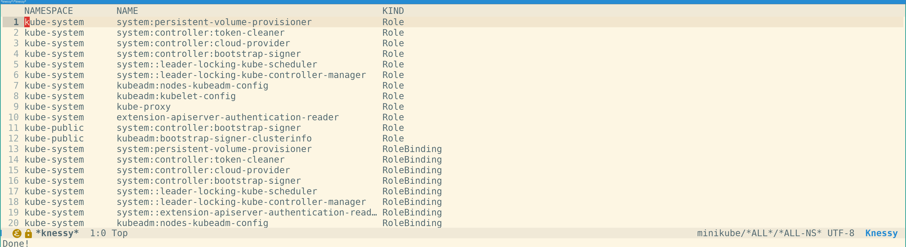
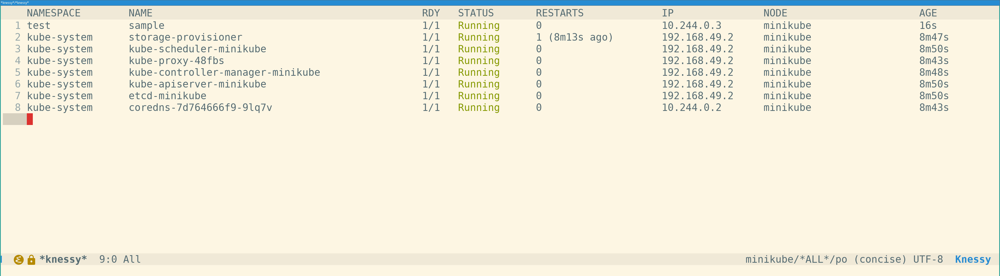
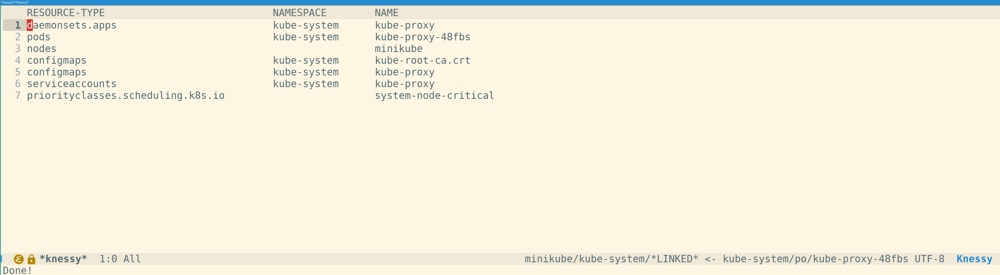
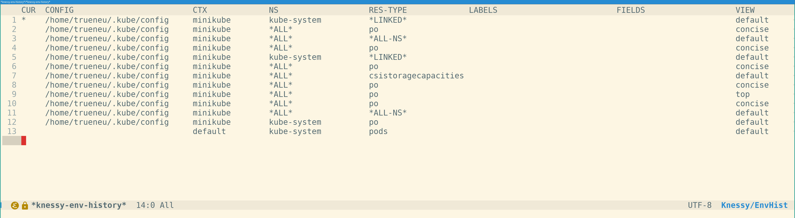

# Knessy

A k9s-style Kubernetes interface for Emacs.

Heavily inspired by abrochard's [kubel](https://github.com/abrochard/kubel) and [k9s](https://github.com/derailed/k9s) by derailed.

## Pictures!

All namespaced resources in all namespaces:


Pods in all namespaces (this particular minikube setup is very boring, yes):


All resources linked to a kube-proxy pod:


History of environment states for quick navigation:


## What and why?

Knessy is a (yet another) Kubernetes-management package, with focus on discoverability and being able to juggle multiple contexts.

It enables you to discover and edit your Kubernetes resources, in multiple contexts, across multiple namespaces, issue operations
in bulk, with quick navigation between related resources, all from comfort of your beloved ~~text editor~~ ~~Lisp machine~~ ~~operating system~~ Emacs.

I have built it for myself and my specific needs. I believe you could benefit from it the most if:
- you manage a lot of large (100K+ CPU cores) Kubernetes clusters at once;
- you debug, troubleshoot and investigate Kubernetes-related stuff on daily basis;
- you experiment with your Kubernetes setup a lot.

If your Kubernetes needs boil down to occasional surgical intervention, this package is most likely an overkill.

## Installation

Requirements:

- Emacs 31.1 or newer
- `kubectl`
- Optional: `vterm` or `ghostel` (for shelling into pods), `embark` (only one contextual action defined for namespaces, but probably
  more to come), `marginalia` for annotations

Direct transients: `aio`, `asoc`, `dash`, `ht`, `s`, `transient`


Clone the repository and add it to your `load-path`:

```elisp
(add-to-list 'load-path "/path/to/knessy")
(require 'knessy)
```

Run `M-x knessy-new` to open a Knessy buffer.

Example `use-package` with `straight`:
```elisp
(use-package knessy
  :straight (:type git :host github :repo "trueneu/knessy")
  :custom
  (knessy-kubectl (expand-file-name "~/.local/bin/kubectl-wrapper"))
  (knessy-kubeconfig (expand-file-name "~/.kube/docker-desktop"))
  (knessy-shell-terminal 'ghostel)
  (knessy-initial-context "docker-desktop")
  (knessy-initial-namespace "kube-system")
  (knessy-initial-resource-type "daemonsets")
  :bind
  (("C-c k n" . knessy-new)
   ("C-c k a" . knessy-apply-arbitrary)
   ("C-c k k" . knessy-delete-arbitrary)
   ("C-c k b" . knessy-switch-buffer)))
```

This package is under somewhat heavy development, so I'd just use whatever is at tip of master. There's currently no plans to
publish it on MELPA or ELPA.

### Snippets

If you're using `display-line-numbers-mode` or `persp-mode`, you may benefit from something like
```elisp
(defun my/display-line-numbers-off ()
  (when (and (boundp 'display-line-numbers) display-line-numbers)
    (display-line-numbers-mode -1)))
(defun my/persp-mode-add-knessy ()
  (when (and (boundp 'persp-mode) persp-mode)
    (persp-add-buffer (current-buffer))))
(defun my/knessy-mode-hook ()
  (my/display-line-numbers-off)
  (my/persp-mode-add-knessy))

(add-hook 'knessy-mode-hook #'my/knessy-mode-hook)
```

If you're using `consult`, you can add a buffer source like this:
```elisp
(defvar consult--source-knessy
  `(:name "Knessy"
    :narrow ?k
    :hidden t
    :category buffer
    :state ,#'consult--buffer-state
    :items ,(lambda ()
              (consult--buffer-query :mode 'knessy-mode
                                     :sort 'visibility
                                     :as #'buffer-name)))
  "Knessy buffer candidate source for `consult-buffer'.")

(add-to-list 'consult-buffer-sources 'consult--source-knessy)
```

## Overview and workflow

Knessy revolves around having a central interactive buffer (there may be multiple) built on top of `tabulated-list-mode`, with
environment state attached to it -- i.e., context, namespace, resource type and filters. That buffer serves as your "window" into
the Kubernetes state.

As you change any state portion, hit `g` to explicitly tell Knessy to invoke kubectl and refresh the buffer contents. This is done
specifically to not interfere with your flow if you need to change more than one variable at a time. Kubectl is called in async
fashion, though rendering a large table will still block your Emacs. Knessy lacks automatic refresh logic to avoid making
excessive expensive calls.

From the central buffer, you can also change the environment state with additional commands grouped under `knessy-jump` (`j`) transient prefix:
- jump to children of the resource
- jump to owner
- jump to pod's node, or node's pods
- jump to resource's namespace
- jump to all resources linked to the resource at point (heavily inspired by [kubectl-tree](https://github.com/ahmetb/kubectl-tree) by ahmetb)

And as a bonus, jump to node provider's page (public or private cloud), which doesn't really change your environment, but opens a
URL in the browser of choice. Public providers currently supported are AWS, Azure and Aliyun.

You can filter resources by labels, fields, or with a regex. The regex filter works like `occur` - it may match any part of
displayed information.

Besides, Knessy supports artificial namespace `*ALL*`, standing for all namespaces in the cluster, and artificial resource types:
`*ALL-NS*` and `*ALL-CLUSTER*`, standing for all namespaced and cluster-scoped resources respectively.

For commands that make sense to be applied to multiple resources, you can first mark candidates with `m`, and apply
the operation in bulk, for example, kill a bunch of resources; or view logs for multiple pods at once.

Custom resources are first-class citizens. Pods/containers are somewhat special because exec'ing into and logs, but other than
that, there's practically no special treatment.

Knessy tries to cache early and aggressively, utilizing async operations. It caches your contexts, namespaces and available
resource types the moment you open first Knessy buffer. It also caches pods labels as soon as you view the pods.

You can customize your views per resource type; for example, the "top" view for pods grabs additional information on current
container resource usage, applies pre- and post-processing to it, and outputs in a form similar to k9s "pods" view. Another view
available modifies CSIStorageCapacities view if those are bound to nodes, showing the node name and reported capacity in a
human-friendly format.

Sorting respects semantics, and tries to treat bytes, CPU cores and time units correctly.

You also have ability, while being in an arbitrary buffer with a Kubernetes manifest open, load it into last selected
environment context.

### Default bindings

Inside a Knessy buffer, the main keys are:

|Key            |Command                                          |What it does                                                                                                  |
|---------------|-------------------------------------------------|--------------------------------------------------------------------------------------------------------------|
|`g`            |`knessy--display2` |Invoke kubectl and refresh current buffer. Akin to `revert-buffer` |
|`c`            |`knessy-config`                                  |Pick resource type, namespace, context, kubeconfig file or view                                               |
|`f`            |`knessy-filter`                                  |Filter by label, field selector or regex                                                                      |
|`j`            |`knessy-jump`                                    |Jump to children, linked resources, owner, node, node pods or namespace, or open the node's provider page     |
|`d` / `e`      |`knessy-describe` / `knessy-edit`                |Describe or edit the resource (YAML, JSON with prefix arg)                                                    |
|`l`            |`knessy-log`                                     |Show logs, with follow, tail and container options                                                            |
|`s`            |`knessy-shell`                                   |Shell into a pod, choosing the container with `-c` (terminal set by `knessy-shell-terminal`: vterm or ghostel)|
|`F`            |`knessy-port-forward`                            |Start port forwarding                                                                                         |
|`k`            |`knessy-kill`                                    |Delete resources, with cascade and grace period options                                                       |
|`m` / `u`      |`knessy-mark` / `knessy-unmark`                  |Mark resources to act on several at once (`M` / `U` for all)                                                  |
|`[` / `]` / `z`|`knessy-env-go-back` / `-forward` / `-history`   |Move through your history of environments (context, namespace, resource type, filters)                        |
|`b` / `K`      |`knessy-switch-buffer` / `knessy-cleanup-buffers`|Switch between and clean up Knessy buffers                                                                    |

Also available: `knessy-apply-arbitrary` and `knessy-delete-arbitrary` to apply or delete manifests from files.

## Customization

All options live in the `knessy` customization group. For all the options available, please see [CUSTOMIZATION.md](CUSTOMIZATION.md); here are just the main ones:

| Option | Default | What it does |
|--------|---------|--------------|
| `knessy-kubectl` | `"kubectl"` | Path to the `kubectl` binary. Point it at a specific build or a wrapper script. |
| `knessy-kubeconfig` | `$KUBECONFIG` | Kubeconfig path. Do not use several files separated by `:`. Switch it on the fly with `c f`. |


## Notes on other packages

Please take a look at all of them to make up your own mind! I only wrote Knessy because none of the packages listed below worked
for me; your mileage may vary greatly, and you may find out other packages fit your needs much better than Knessy.

There are many packages for Kubernetes management out there. And I probably missed and didn't even try some. For ones I tried,
what follows is my personal, subjective opinion about them, please take it with a grain of salt. Also, the fact I didn't end up
using those doesn't mean they're bad. Their GitHub pages have hundreds of stars and dozens of forks!

Knessy doesn't do everything these packages do, especially in permissions and proxying lands, so again - you might find others
work for you way better than Knessy. But contributions are welcome, just saying.

### [kubel](https://github.com/abrochard/kubel): main source of inspiration

I started this project as a patch for kubel to support artificial "all namespaces" switch. It blew up to support dozens of other
things, rewriting kubel's core logic, at which point it became clear Knessy could be a separate package altogether.

Kubel opens a separate buffer for each context/namespace/resource type combination, and I'd quickly find myself disoriented. It's
also sync-only; it really hurts when you list 3000 pods in a cluster on the other side of the planet. To be fair, it's not
specific to kubel - IIRC all the packages listed here are sync-only. Please correct me if I'm wrong.

That said, Knessy follows kubel's UI style very closely, so if you used kubel before, chances are you'll feel at home. And I think
UI is what kubel and k9s nail almost perfectly.

### [kubernetes-el](https://github.com/kubernetes-el/kubernetes-el)

Sadly, this package would just choke and die on cluster sizes I routinely work with. It looked very cool when ran against my
minikube though! It also doesn't provide first-class custom resource support, which is crucial for me.

### [kele](https://github.com/jinnovation/kele.el)

The design philosophy doesn't click with me: in my opinion, kele lacks discoverability and ability to juggle half-a-dozen clusters
at the same time, which might be needed during troubleshooting sessions. It should be a fine package if you know precisely what
needs to be done, however.

It's also the only package I know of that uses Kubernetes API instead of calling kubectl, which is definitely a win.

### [kubed](https://github.com/eshelyaron/kubed)

Kubed suffers from the same custom resources integration problem as kubernetes-el. I didn't look much beyond that to be honest, as
the workflow and navigation seemed cumbersome to me.

Judging from the documentation, it has very nice filtering capabilities though.

### [k9s](https://github.com/derailed/k9s)

Not an Emacs package, but I just have to list it here. It's customizable, fast and feature-rich. Again, its UI feels very natural
and logical, it's very well worth replicating. Its main con is stated in the first few words of this paragraph - it is, sadly, not
an Emacs package.

## Caveats

Knessy is built with assumption that the user owns the cluster. It doesn't do any dynamic permission detection that some other
packages do.

If you ever suspect your cache is borked, run `M-x knessy-caches-refresh`.

I suspect you'd have problems if logging into your Kubernetes clusters requires anything interactive. If you can, login everywhere
before opening Knessy buffers.

Knessy creates a ton of temporary buffers to handle fetching data and parsing. Some of those may be left over, especially if there
are any errors encountered. You can use those buffers when filing issues to get debug information. If you find you don't need
them, kill those with `C-u M-x knessy-cleanup-buffers` (`C-u K` from Knessy buffer).

I'm using Emacs built from the tip of master, so please take the dependencies versions with a grain of salt. If it turns out
there's a mistake somewhere, do tell. In principle, it should work perfectly fine with Emacs older than 31.

It's my first serious and public Elisp effort, the code quality is lacking. Also, parts of the package were developed by an LLM.
Core parts, however, are written by hand.

## Remarks

Despite this being a somewhat janky project, I have been using it myself for several months, and it has greatly improved my
experience of working with Kubernetes. Hope it can help you too!

It helps most when I need to compare the state across a few different clusters, find several resources that wrongly refer to a
single one, or conduct experiments involving creating and deleting a lot of resources at once in qucik succession.

## Contributing

The code is not very clean. It prints a lot of messages, sometimes generates noise, and a sizable portion of it was written with
the help of LLMs, so expect rough edges, leftover TODOs and uneven style.

Contributions are always welcome, as long as they point at an existing problem or solve one. That can be a bug report, a rough
edge you ran into, or a pull request that fixes either of those. Constructive feedback is welcome too, whether it is about the
code, the behavior or this README.

I'd love some help dealing with those leftover TODOs, and general polishing can't hurt. :)

## License

GNU GPLv3 or later. You can find the full text in [LICENSE](LICENSE).
